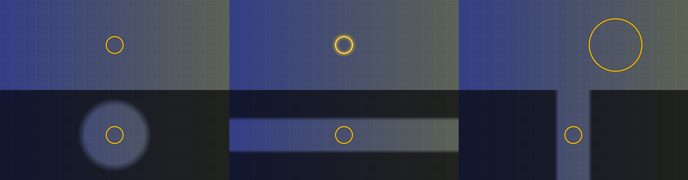
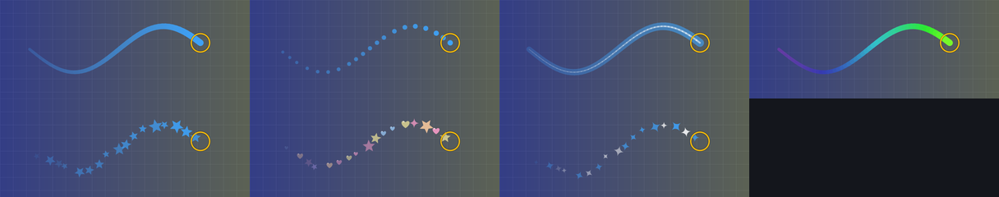
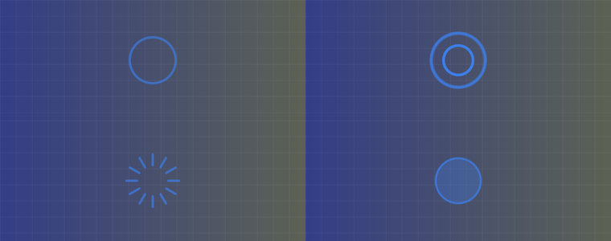
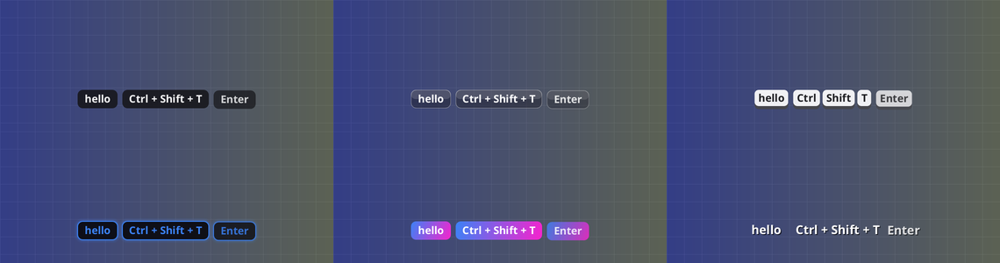
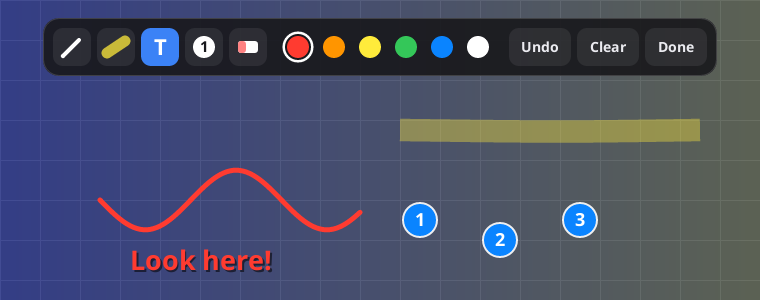
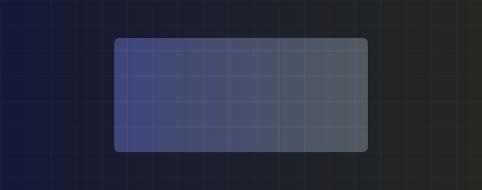
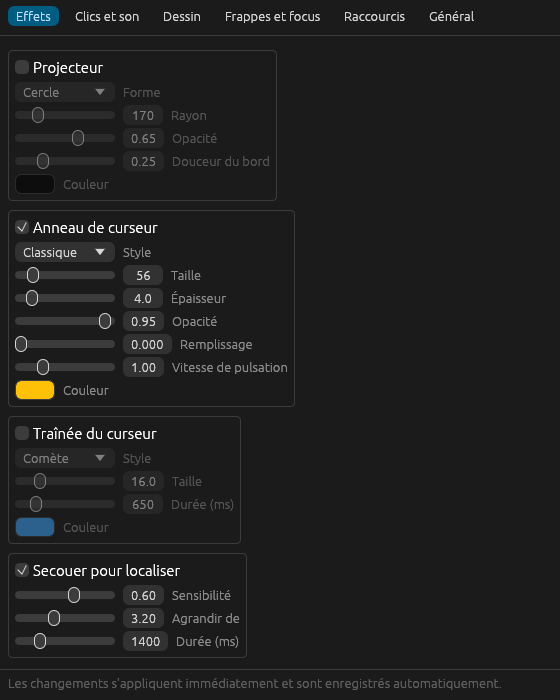

# Sourizz

[English](README.md) · **Français**

Une mise en valeur du curseur pour Linux. Placez un **projecteur**, un **anneau**, une **traînée** ou une **ondulation de clic** sur votre pointeur, affichez vos **frappes au clavier** et **dessinez sur l'écran** — pour des présentations, des tutoriels, des captures vidéo, ou simplement pour ne plus perdre votre curseur sur un grand écran. Fonctionne sous **X11 et Wayland**.

Sourizz est une réécriture indépendante pour Linux de l'idée de [Mouzz](https://mouzz.dev) sur macOS. Il ne partage ni code ni ressources avec lui et n'est ni affilié à son auteur ni approuvé par lui.



## Fonctionnalités

| | |
|---|---|
| **Projecteur** | Assombrit tout sauf un cercle, une barre horizontale ou une barre verticale aux bords doux autour du pointeur. Rayon, opacité, douceur et couleur réglables. |
| **Anneau de curseur** | Un anneau qui suit le pointeur, avec une légère pulsation. Style Classique ou Néon ; taille, épaisseur, couleur, remplissage et vitesse de pulsation réglables. |
| **Traînées** | Sept styles : Comète, Points, Ruban, Arc-en-ciel, Étoiles, Kawaii, Paillettes. |
| **Effets de clic** | Anneau simple, ondulation, éclat ou pulsation, avec une couleur différente pour les boutons gauche, du milieu et droit. Peut aussi se déclencher à la demande par un appui bref sur une touche ou un raccourci. |
| **Sons de clic** | Un clic synthétisé intégré, ou votre propre fichier WAV. |
| **Secouer pour localiser** | Secouez la souris et l'anneau grossit pour retrouver le pointeur. |
| **Dessiner à l'écran** | Maintenez une touche et bougez le pointeur pour tracer des traits qui s'effacent. Ou ouvrez le **mode annotation** : stylo, surligneur, texte, pastilles numérotées, gomme, annuler. |
| **Visualiseur de frappes** | Six styles (Classique, Verre, Touches, Néon, Dégradé, Minimal). La saisie est regroupée en une pastille de texte ; les raccourcis s'affichent sous la forme `Ctrl + Shift + T`. Une option « seulement les raccourcis » masque la saisie ordinaire. |
| **Mode focus** | Assombrit tout sauf la fenêtre active (X11 uniquement pour l'instant). |
| **Le reste** | Icône de zone de notification avec bascules et choix de styles, fenêtre de réglages, raccourcis globaux, ligne de commande pour l'automatisation, interface en français et en anglais. Les réglages s'appliquent en direct. |







### Comparaison avec Mouzz

Sourizz couvre les fonctions de la version gratuite de Mouzz (projecteur, anneau, traînées, effets et sons de clic, secouer pour localiser, dessin, raccourcis globaux, contrôle depuis la barre de menus / zone de notification) et, parmi celles de sa version Pro, le visualiseur de frappes, le mode focus et les outils d'annotation surligneur, texte et pastilles numérotées.

Différences et manques :

- **Touche de dessin maintenue.** Mouzz utilise la touche `Fn`, que les claviers Linux ne signalent généralement pas (c'est le micrologiciel qui la gère). Ici, la valeur par défaut est la touche `Ctrl` de droite, modifiable dans les réglages.
- **Non implémentés :** l'enregistreur d'écran, les sous-titres automatiques, la bulle caméra, le zoom en direct / zoom automatique au clic et la loupe. Sous Linux, ce sont d'autres outils (OBS, `wf-recorder`, l'effet Zoom de KDE…).
- **Le mode focus** a besoin de la géométrie de la fenêtre active, que seul X11 fournit à tous les programmes.

## Installation

Il faut une [chaîne d'outils Rust](https://rustup.rs) stable récente (développé avec la 1.98 ; le projet utilise l'édition 2024). **Aucun paquet `-dev` n'est nécessaire** : la compilation est en Rust pur et charge `libxkbcommon` à l'exécution. La première compilation prend quelques minutes car la fenêtre de réglages embarque egui ; `cargo build --release --no-default-features` compile le démon seul. Si Rust est absent, `./install.sh` propose de l'installer avec rustup (il faut `curl` ou `wget` et un éditeur de liens C comme `build-essential` ; ajoutez `--yes` pour ne pas poser la question).

```sh
git clone <ce dépôt> sourizz && cd sourizz
./install.sh                # installe dans ~/.local (--uninstall pour retirer)
sourizz doctor              # vérifie votre système
sourizz                     # lance le démon (une icône apparaît dans la zone de notification)
sourizz autostart enable    # facultatif : lancement à l'ouverture de session
```

Prérequis à l'exécution :

- **X11 :** un gestionnaire de fenêtres avec composition (KWin, Mutter, Xfwm4, Picom…) pour que la surcouche puisse être transparente. Le serveur X doit offrir XInput2, RandR et Shape (tous standards).
- **Wayland :** un compositeur qui implémente `wlr-layer-shell` — voir le [tableau de compatibilité](#x11-et-wayland).
- **Facultatif :** `pw-play`, `paplay` ou `aplay` pour les sons de clic ; une zone de notification compatible avec le standard StatusNotifierItem (KDE l'est — testé ; GNOME demande l'extension *AppIndicator* ; ailleurs cela dépend de votre tableau de bord — sans zone de notification, tout fonctionne quand même via la ligne de commande, les raccourcis et la fenêtre de réglages) ; OpenGL pour la fenêtre de réglages.

## Utilisation

**Icône de notification.** Un clic gauche active/désactive tout ; un clic droit ouvre le menu avec chaque effet, le choix des styles, le mode annotation, les réglages et « Quitter ».

**Fenêtre de réglages.** `sourizz settings` (ou le menu de l'icône). Les changements sont appliqués immédiatement au démon en cours d'exécution et enregistrés automatiquement.



**Raccourcis** (X11 ; modifiables). Sous Wayland, associez plutôt les [commandes ci-dessous](#ligne-de-commande) dans les raccourcis de votre bureau — voir la [configuration Wayland](#configuration-wayland).

| Par défaut | Action |
|---|---|
| `Ctrl+Alt+Shift+M` | Interrupteur général |
| `Ctrl+Alt+Shift+S` | Projecteur |
| `Ctrl+Alt+Shift+R` | Anneau |
| `Ctrl+Alt+Shift+T` | Traînée |
| `Ctrl+Alt+Shift+C` | Effets de clic |
| `Ctrl+Alt+Shift+K` | Frappes |
| `Ctrl+Alt+Shift+F` | Mode focus |
| `Ctrl+Alt+Shift+A` | Mode annotation |
| `Ctrl+Alt+Shift+X` | Effacer les annotations |
| `Ctrl+Alt+Shift+Y` | Montrer l'effet de clic à l'emplacement du pointeur |

Le mode annotation et l'aperçu du clic activent ce dont ils ont besoin (l'interrupteur général, et les effets de clic pour l'aperçu) lorsque c'est éteint.

**Dessiner.** Maintenez la touche `Ctrl` de droite et bougez le pointeur : un trait suit, puis s'efface après le relâchement. Pour plus de contrôle, ouvrez le **mode annotation** : une barre d'outils apparaît et la surcouche capture la souris et le clavier.

En mode annotation : `P` stylo, `H` surligneur, `T` texte, `N` pastille numérotée, `E` gomme, `1`–`6` couleur, `+`/`-` épaisseur, `Ctrl+Z` ou `Retour arrière` annuler, `Suppr` tout effacer, `Échap` quitter. Pendant la saisie d'un texte, `Entrée` valide.

### Ligne de commande

Tout ce que fait l'icône est scriptable ; c'est aussi ainsi qu'on associe des raccourcis sous Wayland.

```sh
sourizz toggle spotlight        # all, spotlight, ring, trail, clicks, sound, shake,
sourizz on trail                #   annotate, keystrokes, focus
sourizz off keystrokes
sourizz set ring.size 90        # n'importe quelle option du fichier de configuration
sourizz set trail.style stars
sourizz annotate                # bascule le mode annotation  (annotate clear : effacer)
sourizz show-click              # joue l'effet de clic à l'emplacement du pointeur
sourizz status                  # affiche l'état courant
sourizz settings | reload | quit
sourizz config                  # affiche le chemin du fichier de configuration (--defaults : valeurs par défaut)
sourizz doctor                  # diagnostique votre installation
```

### Configuration

`~/.config/sourizz/config.toml` ; chaque clé est facultative. Le fichier est surveillé : les modifications s'appliquent instantanément. `sourizz config --defaults` affiche la liste complète.

```toml
[ring]
style = "neon"          # classic | neon
size = 64.0
color = "#00E5FF"

[spotlight]
enabled = true
shape = "circle"        # circle | hbar | vbar
radius = 200.0
opacity = 0.7

[trail]
enabled = true
style = "kawaii"        # comet | dots | ribbon | rainbow | stars | kawaii | sparkles

[clicks]
style = "ripple_wave"   # single_ring | ripple_wave | burst | pulse
show_on_clicks = true
tap_key = "Control_L"   # affiche aussi l'effet quand on tape brièvement cette touche (vide = désactivé)

[annotate]
hold_key = "Control_R"  # maintenir + bouger pour dessiner ; vide = désactivé

[hotkeys]
spotlight = "Ctrl+Alt+Shift+S"
```

## X11 et Wayland

Sourizz a un seul moteur de dessin et deux backends d'affichage ; il choisit le bon automatiquement (`--backend x11|wayland` ou `general.backend` pour en imposer un).

| Session | Surcouche | Position du pointeur | Clics et touches | Mode focus |
|---|---|---|---|---|
| **X11** (tout gestionnaire avec composition) | oui | exacte | oui, via XInput2 | oui |
| **KDE Plasma, Wayland** | oui | exacte, via un script KWin | demande le groupe `input` | – |
| **Hyprland** | oui | exacte, via son socket IPC | demande le groupe `input` | – |
| sway, river, niri, labwc, COSMIC… | oui | *estimée* (voir ci-dessous) | demande le groupe `input` | – |
| **GNOME, Wayland** | **non** — Mutter n'a pas de layer-shell | – | – | – |

Sous GNOME, ouvrez une session **« GNOME sur Xorg »**, ou utilisez un autre bureau. (Une extension GNOME Shell pourrait le faire nativement ; elle n'est pas encore écrite.)

### Choisir le backend

Par défaut, Sourizz suit votre session : il utilise Wayland si `WAYLAND_DISPLAY` est défini et que `$XDG_SESSION_TYPE` n'est pas `x11`, et X11 sinon. `sourizz doctor` affiche la session et le backend qui sera utilisé (`echo $XDG_SESSION_TYPE` indique aussi dans quelle session vous êtes).

Pour en imposer un, utilisez `sourizz --backend x11` ou `--backend wayland`, ou écrivez `backend = "x11"` (`"wayland"`, `"auto"`) sous `[general]` dans le fichier de configuration — la fenêtre de réglages l'offre dans l'onglet *Général*. L'option de la ligne de commande l'emporte sur le fichier. Le backend est choisi au démarrage : **relancez le démon** après l'avoir changé. Imposer X11 dans une session Wayland est rarement utile : un programme X11 n'y voit généralement le pointeur que lorsqu'il est au-dessus d'autres fenêtres X11.

La session elle-même se choisit sur l'écran de connexion (par exemple « Plasma (X11) » ou « Plasma (Wayland) »).

**Pourquoi Wayland est plus difficile.** Par conception, un programme Wayland ne voit ni le pointeur ni le clavier quand une autre fenêtre les a. Sourizz contourne cela sans aucun assistant privilégié :

- la surcouche est une surface `wlr-layer-shell` traversable (une région d'entrée vide laisse passer tous les clics) ;
- la **position du pointeur** vient du compositeur quand il sait la donner (KWin, Hyprland) ; sinon elle est *estimée* en additionnant le mouvement relatif de la souris, ce qui dérive car le compositeur applique une accélération que Sourizz ne voit pas. Considérez-la comme approximative dans ce cas ;
- les **clics et frappes** sont lus dans `/dev/input/event*` ;
- la **disposition du clavier** pour les libellés vient de `XKB_DEFAULT_LAYOUT`, de `/etc/default/keyboard` ou du `kxkbrc` de KDE ;
- le **mode annotation** prend une vraie capture du pointeur et du clavier : il est donc exact sur tous les compositeurs.

### Configuration Wayland

1. Autorisez Sourizz à lire les périphériques d'entrée (nécessaire seulement pour les effets et sons de clic, le visualiseur de frappes, le dessin à touche maintenue et les raccourcis internes ; l'anneau, le projecteur et la traînée fonctionnent sans cela sous KDE et Hyprland) :

   ```sh
   sudo usermod -aG input "$USER"      # puis fermez et rouvrez la session
   ```

   > **Note de sécurité.** Les membres de `input` peuvent lire chaque frappe de la machine, donc n'importe quel programme que vous lancez le pourrait. Sourizz ne transforme les événements qu'en effets à l'écran et en raccourcis : il ne stocke rien, n'écrit rien dans des journaux et n'a aucun code réseau — mais vous accordez cette permission à tout votre compte. Si vous préférez ne pas le faire, sautez cette étape : la surcouche et tout ce qui dépend de la position du pointeur fonctionnent quand même sous KDE et Hyprland, et le mode annotation n'en a jamais besoin.

2. Associez des raccourcis dans votre bureau, car Wayland n'offre pas d'API de raccourcis globaux aux programmes ordinaires (Sourizz reconnaît aussi vos raccourcis configurés à partir du clavier brut quand il y a accès, mais cela ne peut pas *consommer* la frappe) :
   - **KDE :** Configuration du système → Clavier → Raccourcis → Ajouter une commande → `sourizz toggle spotlight`
   - **Hyprland :** `bind = SUPER SHIFT, S, exec, sourizz toggle spotlight`
   - **sway :** `bindsym $mod+Shift+s exec sourizz toggle spotlight`

3. `sourizz doctor` vous indique ce qui manque.

Limite connue : sur les sorties HiDPI avec un facteur d'échelle supérieur à 1, la surcouche est dessinée en 1× puis agrandie par le compositeur, ce qui la rend légèrement floue (les positions restent correctes).

Limite connue : sous KDE Plasma Wayland (KWin 6.3.6, portable à GPU hybride Intel UHD 630 + NVIDIA MX250), le pointeur se fige environ une demi-seconde toutes les deux à trois secondes tant qu'une **traînée** est dessinée. L'anneau seul ne le provoque pas, ni Sourizz avec tous les effets coupés. Sourizz lui-même n'est pas bloqué pendant ces gels et la zone qu'il redessine est petite : la cause se trouve dans la façon dont KWin traite ces mises à jour continues sur ce matériel, et elle n'est pas encore comprise. Sur une telle configuration, désactivez la traînée (`sourizz set trail.enabled false`) ou utilisez la session X11. L'anneau peut aussi traîner légèrement derrière un pointeur rapide sous Wayland, car sa position suit un chemin plus long (script KWin puis D-Bus) que les événements bruts XInput2 utilisés sous X11.

## Ce qui a été testé

En toute honnêteté sur la vérification :

- **Automatisé :** 57 tests unitaires (configuration, moteur, suivi des zones à redessiner, invariants de rendu, gestion des touches avec de vraies dispositions AZERTY/QWERTY, traduction evdev, analyse des commandes). En particulier, un test de propriété vérifie que le redessin incrémental est identique au pixel près à un redessin complet pour chaque forme de projecteur, style de traînée et effet de clic.
- **X11 :** éprouvé en conditions réelles sous Debian 13, KDE Plasma 6.3, deux écrans — fenêtres de surcouche, traversée des clics, dessin de l'anneau / des clics / des traînées, aucun pixel fantôme après un mouvement rapide, raccourci global, ligne de commande, rechargement de la configuration en direct, menu de l'icône via D-Bus, fenêtre de réglages.
- **Wayland :** éprouvé contre un compositeur **KWin 6.3** imbriqué — surcouche layer-shell, rendu de l'anneau / du projecteur / de la barre d'annotation, capture du mode annotation, script KWin de position du pointeur. Lancé aussi dans une vraie session KDE Plasma 6.3.6 Wayland (voir la limite sur la traînée ci-dessus) : l'anneau suit le pointeur grâce au script KWin et les vrais périphériques souris, pavé tactile et clavier sont ouverts. **Non vérifié** en session réelle : effets et sons de clic, affichage des touches et mode annotation. **Non testé** en vrai HiDPI, sous GNOME, Hyprland, sway, niri ou d'autres compositeurs.

Considérez la prise en charge de Wayland comme une première version solide qui demande davantage de tests sur le terrain ; les rapports de bogues accompagnés de la sortie de `sourizz -vv` sont bienvenus.

## Vie privée

Tout s'exécute en local. Sourizz n'ouvre aucune connexion réseau et n'écrit rien d'autre que son fichier de configuration (et quelques fichiers d'exécution : le socket de contrôle, un petit WAV de clic et le script KWin dans `$XDG_RUNTIME_DIR`).

Le visualiseur de frappes affiche ce que vous tapez ; il est **désactivé par défaut**. Lors d'un partage d'écran, préférez « seulement les raccourcis » pour ne jamais afficher de mot de passe.

## Développement

```sh
cargo test                                    # tests unitaires et de propriété
cargo run --release -- demo out/              # rend chaque effet en PNG, sans écran
cargo run --example x11_probe -- out/         # vérification X11 de bout en bout sur un démon lancé
RUST_LOG=sourizz=debug cargo run -- -vv       # démon verbeux
```

Organisation : `engine.rs` (état + dessin, sans E/S), `canvas.rs` (tampons par écran limités aux zones abîmées), `x11.rs` / `wayland.rs` (backends), `core.rs` (configuration, commandes, icône, son), `evdev_in.rs` / `wlsrc.rs` / `kwin.rs` / `xkb.rs` (entrées Wayland), `src/bin/settings.rs` (fenêtre de réglages egui). Voir `CLAUDE.md` pour les pièges.

Pour tester Wayland sans session Wayland, on peut lancer un compositeur privé : `dbus-run-session -- kwin_wayland --virtual --socket sz --width 1280 --height 720` avec son propre `XDG_RUNTIME_DIR`, puis démarrer Sourizz avec `WAYLAND_DISPLAY=sz` et `SOURIZZ_FAKE_POINTER=640,360`.

## Licence

Sourizz est un logiciel libre, publié sous la **GNU Affero General Public License, version 3 ou (à votre choix) toute version ultérieure** (`AGPL-3.0-or-later`). Voir [LICENSE](LICENSE) (texte officiel en anglais).

En bref : vous pouvez l'utiliser, l'étudier, le modifier et le partager, y compris commercialement, tant que tout ce que vous distribuez — ou proposez aux utilisateurs via un réseau — et qui en dérive reste sous la même licence, avec son code source disponible.

Mouzz est un produit de son propriétaire ; son nom n'est utilisé ici que pour décrire ce qui inspire Sourizz.
